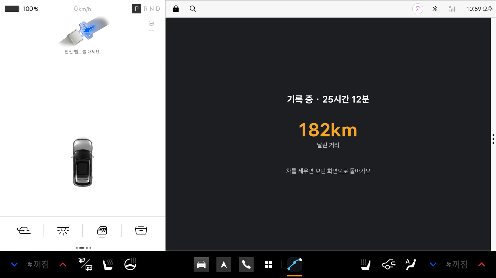
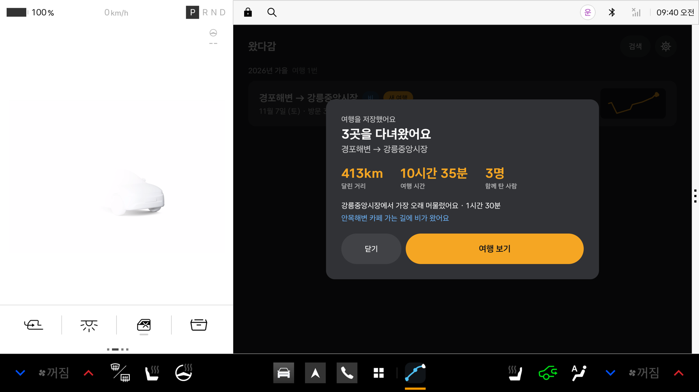
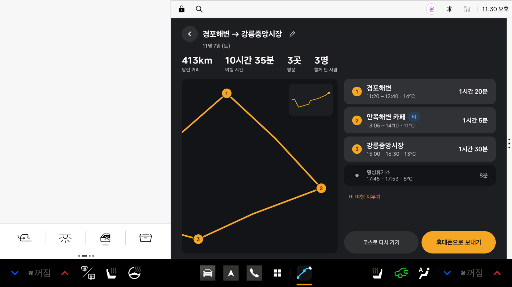
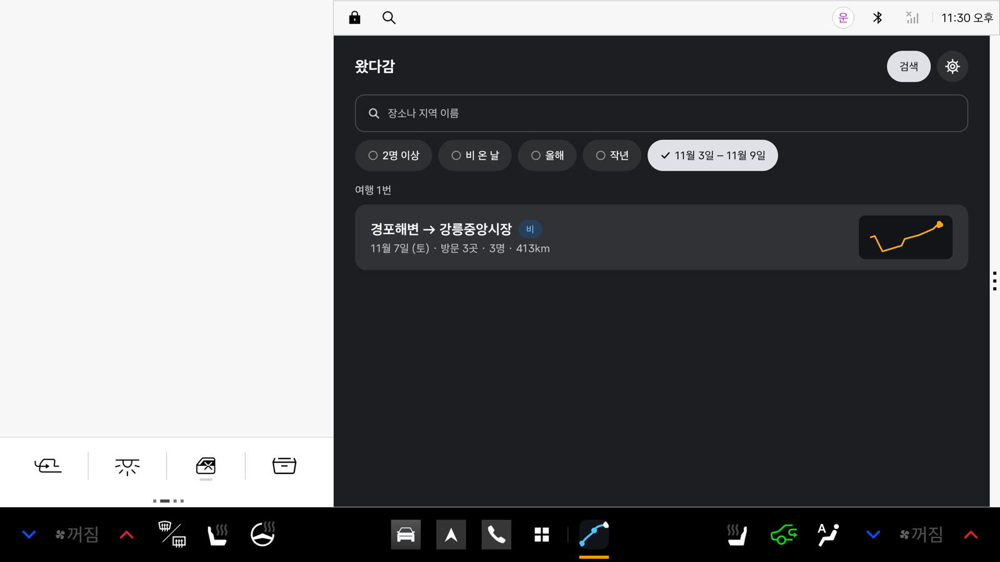
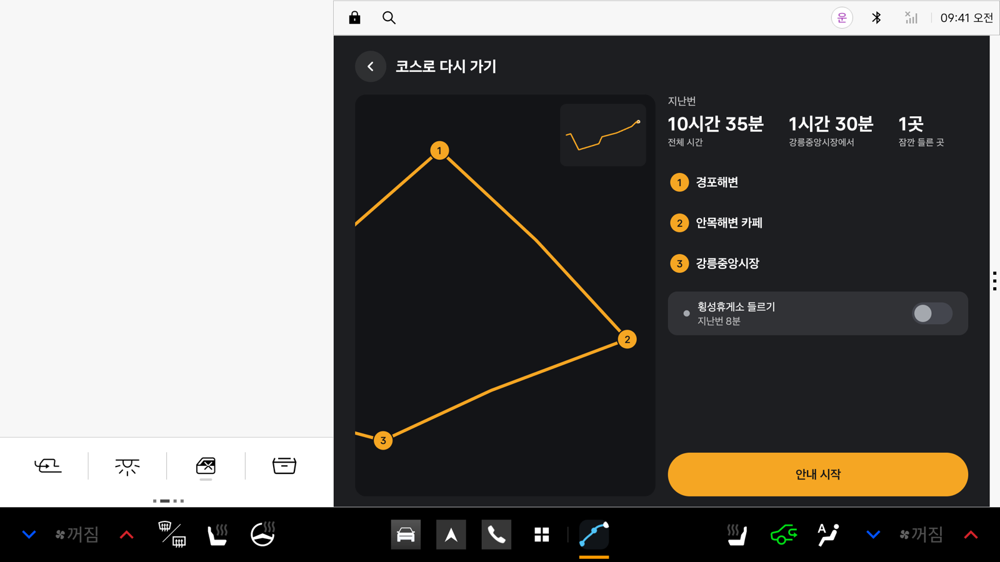
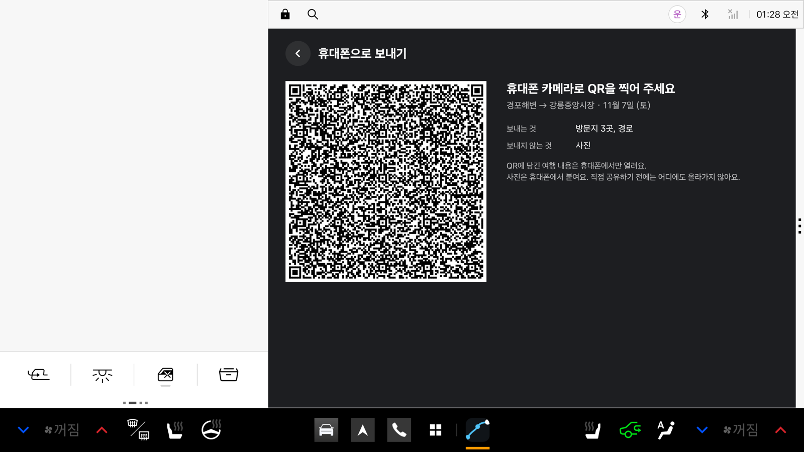
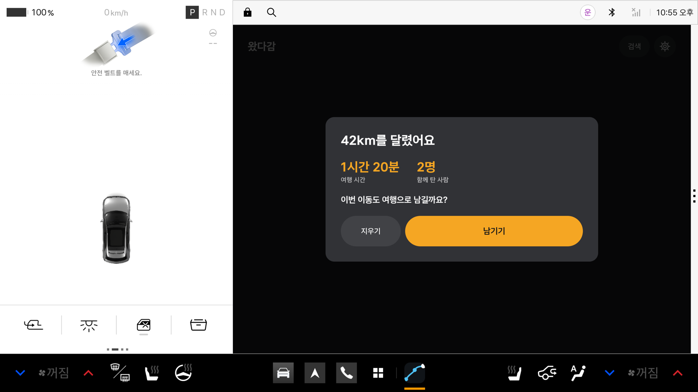
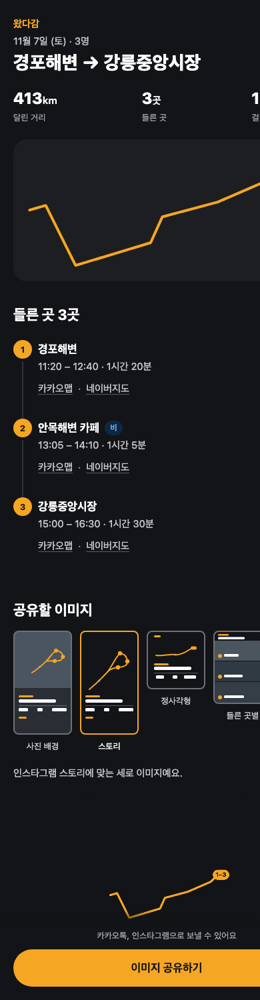

# 02 앱 프로젝트 소개 / 심사 자료

> 원본: 접수양식 기획서 `왔다감_접수양식_앱프로젝트소개_초안.docx`의 "02 앱 프로젝트 소개 / 심사 자료" 부분 (2026-11-15 변환). 작성 안내 문구는 뺐다.

앱명 / 프로젝트명: 왔다감 (Wheel Be Back)

## 1. 앱 한 줄 소개

> 앱을 한 문장으로 소개해 주세요.

기어·도어·좌석 같은 차량 신호로 여행을 자동으로 기록해, 휴대폰으로 사진을 지정해 공유하고 같은 코스로 다시 안내 받을 수 있는 앱입니다.

## 2. 기획 배경

> 어떤 고객의 니즈나 불편한 순간에 주목했으며, 왜 해결이 필요한지 작성해 주세요.

### 주목한 순간

- **여행이 끝난 뒤:** 사진은 남지만 어디를 어떤 순서로 들러 얼마나 머물렀는지는 며칠 지나면 기억하기 어렵습니다. 같은 여행을 다시 가려면 장소를 하나씩 다시 검색해 내비에 넣어야 합니다.

- **운전자:** 운전 중에는 여행을 기록할 수 없습니다. 주행 중에는 화면 조작이 제한되고, 정차하면 내려서 구경하기 바쁩니다.

- **동승자:** 동승자가 찍은 사진은 각자의 휴대폰에 흩어져 있고 들른 장소·시간과 정보는 포함하고 있지 않습니다.

### 휴대폰 앱으로 해결하기 어려운 이유

- 휴대폰 위치 기록은 앱을 켜 두어야 하고, GPS 속도만으로는 신호 대기와 주차를 구분하기 어렵습니다. 걸어서 이동한 기록과 출퇴근 같은 일상 이동도 함께 쌓여, 여행만 골라 보려면 사용자가 직접 정리해야 합니다.

- 차는 기어(P단), 도어 열림, 좌석 탑승, 와이퍼, 내비 목적지와 집·회사 즐겨찾기, 같은 정보들을 이미 갖고 있습니다. 이를 이용하면 사용자가 아무것도 하지 않아도 "차를 세우고 내려서 머문 곳"과 "여행인지 출퇴근인지"를 판정할 수 있습니다.

### 해결 목표

기록 버튼을 누르지 않아도 여행 한 편(들른 곳, 머문 시간, 비, 기온, 함께 탄 사람, 경로)이 차에 정리되어 남고, 그 여행을 다시 찾고, 휴대폰으로 보내 사진을 붙이고, 같은 코스로 다시 갈 수 있게 합니다. 출퇴근은 묻지 않고 걸러 냅니다.

## 3. 앱 주요 기능 및 차량 특화 요소

> 앱의 핵심 기능을 소개하고, 이를 통해 어떤 문제를 해결하며 차량에서 어떤 새로운 경험을 제공하는지 설명해 주세요.

### 핵심 기능

| 기능 | 내용 |
|---|---|
| 자동 기록 | 기어 P→D로 드라이브를 시작하고, P 3분 유지 또는 시동 OFF로 끝냅니다. P단 + 도어 열림 + 10분 이상 머문 곳을 방문지로, 10분 미만은 "잠깐 정차"(휴게소·주유)로 저장합니다. 드라이브 간격이 6시간 미만이면 한 여행으로 묶고, 오전 3시를 포함한 정차는 숙박으로 보아 여러 날 여행을 하나로 이어 붙입니다. |
| 여행과 일상 이동 구분 | 집↔회사 이동이나 단골(최근 30일 3회 이상) 한 곳만 들른 이동은 묻지 않고 "일상 이동"으로 두었다가 7일 뒤 자동으로 지웁니다. 방문지 2곳 이상, 숙박, 집·회사에서 30km 이상 떨어진 이동은 묻지 않고 여행으로 저장합니다. 그 사이의 애매한 이동만 도착 카드에서 한 번 묻습니다. |
| 주행 중 화면 | "기록 중 · 3시간 10분" 한 줄과 숫자 2개(달린 거리, 방문지 수)만 보여 줍니다. 터치와 애니메이션이 없고, 보던 화면은 차를 세우면 돌아갑니다. |
| 도착 카드 | 여행이 끝나 집에서 P단이 되면 "3곳을 다녀왔어요" 요약(달린 거리, 여행 시간, 함께 탄 사람, 가장 오래 머문 곳, 비 온 구간)과 음성 한 문장을 냅니다. |
| 기록 검색 | 장소·지역·제목 검색, 기간(달력), 동승 2명 이상, 비 온 날 필터. 앱을 열면 "1년 전 이맘때" 여행 카드를 맨 위에 보여 주고, 목록은 계절별로 묶습니다. |
| 다시 가기 | 지난 여행의 방문지를 순서대로 내비에 경로로 요청합니다. 구간당 경유지 2개 제한에 맞춰 3곳씩 나누고, 구간 목적지에 도착한 뒤 다시 출발하면 다음 구간을 요청합니다. 지난번 들른 휴게소를 경유지로 넣을 수 있습니다. |
| 휴대폰으로 보내기 | 차 화면의 QR을 휴대폰으로 찍으면 여행이 휴대폰 웹 페이지에 열립니다. 사진을 고르면 촬영 시각(EXIF)으로 방문지에 자동 배치하고, 공유 이미지 4종(스토리, 사진 배경, 정사각형, 들른 곳별)을 만듭니다. 여행 데이터는 URL의 # 뒤에 담겨 서버로 전송되지 않고, 사진은 휴대폰 밖으로 전송되지 않습니다. |

### 차량 특화 요소: 차량 신호에서 판정까지

| 차량 신호 | 앱이 판정하는 것 | 휴대폰 앱만으로는 |
|---|---|---|
| 기어 P/D/R | 드라이브 시작·종료, 주차 | GPS 속도로 추정해야 하고 신호 대기와 주차를 구분하기 어렵습니다 |
| 도어 열림 | 내려서 머문 곳(방문지)과 차 안 대기 구분 | 알 수 없습니다 |
| 좌석 탑승 | 함께 탄 사람 수 | 알 수 없습니다 |
| 와이퍼 | 비 온 구간 | 날씨 API로 추정해야 하고 실제 비와 다를 수 있습니다 |
| 외기온 | 방문지 도착 때 기온 | 날씨 API로 추정해야 합니다 |
| 내비 목적지, 집·회사 즐겨찾기 | 장소 이름, 귀가 판정, 출퇴근 제외 | 사용자가 따로 등록해야 합니다 |
| 주행 중 제한 상태(CarUxRestrictions) | 주행 중 화면 전환과 조작 차단 | 해당 없음 |

차에서의 새로운 경험은 "아무것도 하지 않아도 여행이 정리되어 있는 것"입니다. 기록은 부팅과 함께 시작되는 Foreground Service가 하고, 운전자는 주행 중에 앱을 조작할 일이 없습니다. 여행이 끝나면 차 화면에서 결과를 확인하고, 사진 정리와 공유는 동승자가 휴대폰에서 이어서 합니다.

|  주행 중 화면: 현재 상태 한 줄과 숫자만 표시 |  도착 카드: 집 도착 뒤 P단에서 표시 |
|---|---|
|  여행 상세: 방문지별 시각·머문 시간·기온·비 |  기록 검색: 기간·동승·비 온 날 필터 |
|  코스로 다시 가기: 지난번 소요 시간과 휴게소 경유 여부 기록 |  휴대폰으로 보내기: 보내는 것과 보내지 않는 것 표시 |

화면은 Pleos Connect Emulator v2.1.0에서 시연용 여행 시나리오를 재생해 캡처했습니다. 경로 그림은 시나리오의 주요 지점을 직선으로 이은 근사 경로입니다.

## 4. 주요 사용 시나리오

> 누가, 어떤 상황에서, 어떻게 앱을 사용하는지 구체적인 이용 흐름을 설명해 주세요.

### 대상 사용자

- 주말·연휴에 가족이나 친구와 차로 당일·1박 국내 여행을 다니는 운전자와 동승자. 여행 기록과 사진 정리를 원하지만, 기록 앱을 따로 켜고 끄지는 않는 사람.

- 지인들과 여행 경로를 공유하고 싶은 사람.

- 같은 여행지를 계절마다 다시 찾는 사용자(캠핑, 부모님 댁 방문, 단골 여행지).

### 시나리오 1: 강릉 당일 여행 (운전자 1명, 동승자 2명)

| 상황 | 앱 동작 | 운전자·동승자 |
|---|---|---|
| 아침, 집에서 출발(기어 D) | 드라이브 시작. 주행 중 화면에 "기록 중" 한 줄 | 아무것도 하지 않습니다 |
| 11:20 경포해변 주차, 문을 열고 내림 | P단 + 도어 열림으로 정차 시작. 화면 변화 없음 | 내려서 구경합니다 |
| 12:40 다시 출발 | 80분 머문 곳을 방문지 1로 저장, 도착 때 기온 14°C. 장소 이름은 카카오 로컬 API로 채움 | 아무것도 하지 않습니다 |
| 안목해변 카페로 가는 길에 비 | 와이퍼 ON 구간을 비로 기록 |  |
| 강릉중앙시장, 귀갓길 휴게소 8분 | 시장은 방문지 3, 휴게소는 10분 미만이라 잠깐 정차 |  |
| 저녁, 집 300m 안에서 P단 | 여행을 닫고 "3곳을 다녀왔어요" 도착 카드와 음성 한 문장 | 운전자가 카드를 보고 닫습니다 |
| 집 주차 중 | 여행 상세 → "휴대폰으로 보내기" → QR 표시 | 동승자가 QR을 찍어 휴대폰에서 사진을 고르면 방문지별로 자동 배치되고, 공유 이미지를 카카오톡·인스타그램으로 보냅니다 |
| 다음 해 11월 | 목록 맨 위에 "1년 전 이맘때" 카드. 상세 → "코스로 다시 가기" → 내비에 3곳 경로 요청 | 운전자는 정차 중에 버튼 한 번으로 출발합니다 |

### 시나리오 2: 평일 출퇴근과 퇴근길 마트

집↔회사 이동과 최근 30일 동안 3번 이상 들른 마트만 들른 퇴근길은 묻지 않고 일상 이동으로 둡니다. 목록에는 보이지 않고 7일 뒤 자동으로 지워집니다. 오탐은 운전자가 수정할 수 있습니다.

### 시나리오 3: 집에서 출발해 집으로 돌아온 해안도로 드라이브

들른 곳이 없고 멀리 가지 않은 이동은 여행인지 알 수 없으므로, 도착 카드에서 "이번 이동도 여행으로 남길까요?"라고 한 번 묻습니다. [남기기]는 여행으로 저장하고 [지우기]는 바로 삭제합니다. 답하지 않으면 일상 이동으로 둡니다.

|  애매한 이동에서만 묻는 도착 카드 |  휴대폰 페이지: 들른 곳과 지도 링크 |
|---|---|

## 5. 개발 계획

> Pleos Connect 환경에서 앱을 어떻게 구현할지 주요 개발 범위와 SDK/API 사용계획을 구체적으로 작성해 주세요.

### 현재 개발 상태 (2026-11-15)

- Pleos Connect Emulator v2.1.0에서 동작하는 Android 앱입니다. Kotlin, Jetpack Compose, Room DB, Foreground Service(부팅 뒤 자동 시작)로 만들었습니다. 휴대폰 공유 페이지는 정적 HTML·JS로 만들어 정적 호스팅(Cloudflare Pages)에 배포했습니다.

- 차량 신호·위치·내비 입력을 인터페이스로 분리해, 실제 Pleos SDK 어댑터와 시나리오 재생기(가속 가상 시계)를 같은 판정 코드에 연결합니다. 실차 없이 골든 시나리오 9개(강릉 당일, 제주 2박 3일, 출퇴근 5일, 장거리 귀성, 같은 장소 재정차, 위치 신호 끊김, 집→집 드라이브, 퇴근길 단골 마트, 부모님 댁 1박)를 재생하고 기대 결과를 테스트로 고정했습니다.

- 자동 시험: Kotlin 단위 테스트 406개, 휴대폰 페이지 테스트 105개.

- 에뮬레이터 Virtual Console로 기어·도어 값을 실제로 바꿔, SDK 신호만으로 방문지 1개가 만들어지는 것을 확인했습니다(2026-11-13).

### SDK·API 사용 계획과 확인 상태

| SDK·API | 사용하는 기능 | 앱에서의 용도 | 확인 상태 |
|---|---|---|---|
| Pleos Vehicle 2.3.2 | 기어, 도어, 좌석 탑승, 와이퍼 값 변화 콜백 | 드라이브·방문지 판정, 함께 탄 사람, 비 | 기어·도어: 에뮬레이터 실제 신호로 확인. 좌석: 에뮬레이터와 SDK의 값 해석 차이를 Pleos에 확인 예정. 와이퍼: 확인 예정 |
| Pleos FusedLocation 1.1.3 | 위치 콜백(1초) | 경로 저장(20m 간격), 달린 거리 | 수신 확인 |
| Pleos NaviHelper 3.0.5 | 목적지 정보, HOME/OFFICE 즐겨찾기, 현재 위치, requestRoute, requestRouteWithWaypoints, 도착 콜백 | 장소 이름, 귀가·출퇴근 판정, 위치 대체 경로, 코스로 다시 가기 | 연결·즐겨찾기 조회 확인. 경로 요청은 확인 예정 |
| Pleos TextToSpeech 3.3.1 | 한 문장 발화 | 도착 카드 음성 | 확인(11-09) |
| Pleos SpeechToText 3.3.1 | 1회 인식 | 정차 중 방문지 음성 메모 | 한국어 인식 확인(11-09). 메모 화면은 확인 예정 |
| AAOS CarUxRestrictionsManager | 주행 중 제한 상태 | 주행 중 화면 전환, 조작 차단 | 수신 확인 |
| AAOS CarPropertyManager | 차속, 시동, 외기온 | 기어 신호가 없을 때 대체 판정, 드라이브 종료, 기온 | 차속 수신 확인. 시동·외기온은 에뮬레이터에서 값을 받지 못해 확인 예정 |
| 카카오 로컬 API | 좌표 → 주변 장소, 좌표 → 행정구역 | 방문지 이름, 시·군·구 검색 | 실제 호출 확인(11-15) |

### 안전·권한·개인정보 원칙

- 주행 중에는 distractionOptimized 선언 화면만 보이고 터치를 받지 않습니다. CarUxRestrictionsManager 제한을 따릅니다.

- 차량 제어 API는 쓰지 않고 조회 권한만 씁니다.

- 기록은 기기 안 Room DB에만 저장합니다. 서버·계정·분석 도구가 없고 allowBackup=false입니다. 일상 이동은 7일, 집·회사 추정용 정차 요약(좌표 약 100m 단위)은 30일 뒤 자동으로 지웁니다. 공유할 때는 집·회사 500m 안의 경로와 정차를 뺍니다.

### 2차 PT(12-03)까지 개발 범위

| 기간 | 작업 |
|---|---|
| 11-16-11-22 | 내비 경로 요청(requestRoute, 경유지 구간 이어 붙이기) 에뮬레이터 실제 호출 확인. 좌석·와이퍼·외기온 실제 신호 확인. 휴대폰 공유 페이지 실기기(iOS Safari, Android Chrome) 확인 |
| 11-23-11-29 | 시연 경로를 실제 도로 형상으로 교체. 좁은 창(841px) 화면 확인. 실제 신호로 만든 방문지에 장소 이름이 붙는 흐름 확인 |
| 11-30-12-02 | 주행 중 CPU·RAM 측정(목표 CPU 5% 미만), 개인정보처리방침·이용약관 URL, 시연 리허설 2회 |

## 6. 기대효과 및 발전 가능성

> 사용자에게 제공하는 가치와 향후 서비스 확대·발전 가능성을 작성해 주세요. (타깃 고객 분석, 예상 MAU, Retention Rate, 향후 서비스 확대 계획 등)

### 사용자에게 주는 가치

- **운전자:** 기록을 위해 조작할 일이 없습니다. 같은 여행을 다시 갈 때 장소를 다시 검색하지 않고 버튼 한 번으로 경로를 요청합니다.

- **동승자:** 사진을 고르기만 하면 들른 곳별로 정리되고, 공유 이미지가 바로 만들어집니다.

- **가족 전체:** 여행 한 편이 날짜·장소·날씨·인원과 함께 남아 "그때 어디 갔었지"를 검색으로 찾습니다.

### 타깃 고객

- **1차:** Pleos Connect 차량으로 주말·연휴 국내 여행을 다니는 가족(자녀 동반)과 커플.

- **2차:** 같은 여행지를 반복해서 찾는 캠핑·부모님 댁 방문 사용자, 여행 사진을 SNS에 올리는 사용자.

### 예상 MAU

MAU = Pleos Connect 탑재 차량 수 × 앱 설치율 × 한 달에 여행 기록을 1건 이상 확인하는 비율

| 항목 | 값 | 근거 |
|---|---|---|
| Pleos Connect 탑재 차량 | 약 2,000만 대(2030년) | 현대자동차그룹 발표(2026-04-29): 더 뉴 그랜저에 첫 적용 후 2030년까지 글로벌 약 2,000만 대 탑재 계획 |
| 앱 설치율 | 1-3% | 가정 |
| 월 활성 비율 | 50% | 가정. 여행이 있는 달에는 도착 카드와 목록 확인이 생깁니다 |
| MAU(2030년) | 약 10만-30만 | 위 산식 |

출시 첫해는 국내 신차부터 적용되므로 탑재 대수가 공개되면 같은 산식으로 다시 계산합니다.

### Retention 장치

- **자동 기록:** 설치 뒤 추가 행동 없이 여행이 쌓입니다. 기록 앱의 이탈 원인인 "켜고 끄기를 잊음"이 없습니다.

- **다시 여는 계기:** 여행마다 뜨는 도착 카드, 작년 같은 시기의 "1년 전 이맘때" 카드, 계절별 묶음, 코스로 다시 가기.

- **지표:** 30일 Retention = 설치 30일 뒤에도 여행을 저장하고 목록이나 도착 카드를 연 사용자 비율. 목표 40%(가정). 앱에 분석 도구를 넣지 않으므로 Pleos App Market이 제공하는 설치·실행 통계로 측정합니다(제공 범위는 확인 예정).

### 서비스 확대 계획

| 단계 | 내용 | 데이터 원칙 |
|---|---|---|
| 1. 출시 | Pleos App Market 국내 출시. 무료 | 차 안 저장, 서버 없음 |
| 2. 추천 코스 받기 | 지자체·관광공사·여행 매체가 만든 추천 코스를 내려받아 "코스로 다시 가기"와 같은 방식으로 안내. 코스 경유지 상점 제휴 쿠폰을 수익 모델로 검토 | 코스 목록만 내려받고 사용자 기록은 올리지 않음 |
| 3. 렌터카·차량 공유 | 반납 전에 여행을 QR로 휴대폰에 가져가고 차에서는 기록을 지움. 제주 등 렌터카 여행지 제휴 | 다음 이용자에게 기록이 남지 않음 |
| 4. 해외 | 현대자동차그룹의 북미·유럽·인도 순차 탑재 계획에 맞춰, 장소 이름 API를 지역별 서비스로 교체 | 같은 원칙 유지 |

## 7. 참고자료(선택 · 가산점 부여)

> 앱 화면 시안, 시연 영상, GitHub 저장소 등 아이디어와 개발 결과물을 보여줄 수 있는 자료가 있다면 파일 또는 링크로 제출해 주세요

- 시연 영상: 영상 링크 또는 첨부 파일명 입력

- GitHub 저장소(11-16까지 공개 전환): https://github.com/hyndai-contest-team/trip-recap

- APK: 저장소 apk/ 폴더 tridrive_왔다감_release.apk (release 빌드, 서명)

- 화면 캡처: 이 문서 3·4항에 포함(Pleos Connect Emulator v2.1.0).

## 8. 숏폼 링크(선택 · 가산점 없음) *공모전 본상과 별도로 운영되는 특별상(50만원)

> 게시한 세로 방향 영상의 링크를 기재해 이메일로 제출합니다.

(작성하지 않음)
